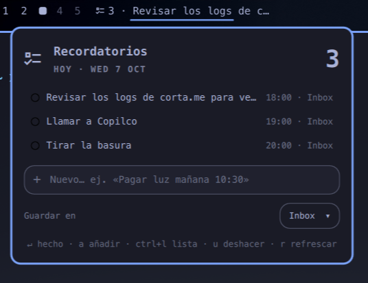

# Apple Reminders for Omarchy

A bar widget for Omarchy that shows today’s and overdue Apple Reminders from iCloud. Complete reminders, undo completion, and add new reminders from the popup.



## Requirements

- Omarchy with its Quickshell plugin system.
- Python 3 with `venv` and `pip` support.
- An unlocked Secret Service keyring, such as GNOME Keyring.
- An Apple account with iCloud Reminders enabled; sign-in supports two-factor authentication.

The helper installs `pyicloud==2.7.0` and `rich` in a private virtual environment. It uses pyicloud’s CloudKit client and private list-sync interfaces.

## Installation

After this repository has been published to GitHub:

```bash
omarchy plugin add https://github.com/ElChacoVeloz/iserrano.apple-reminders.git --enable
~/.config/omarchy/plugins/iserrano.apple-reminders/scripts/apple-reminders install
~/.config/omarchy/plugins/iserrano.apple-reminders/scripts/apple-reminders login
```

Follow the interactive sign-in prompts in your terminal. Use your Apple account password; app-specific passwords are not supported by this helper. The widget also offers a sign-in button.

## Usage

Open the widget to view today’s and overdue reminders across lists, mark them complete, or create reminders. New reminders are due today by default. The input understands Spanish date expressions and some English expressions, for example `Comprar leche mañana`, `Revisar correo sin fecha`, and `Call tomorrow`.

Widget settings include the destination list ID, refresh interval (default: 300 seconds), maximum rows, the next reminder title in the bar, showing when that reminder is due next to it, and hiding the widget when empty. Set the destination list ID explicitly when you want new reminders to go to a specific list.

The bar entry is painted by hand and follows the same shape as the calendar widget, so the two read alike: a dim list glyph, one dot per list that has something due today in that list's own color (the one iCloud stores), the open count, and the reminder that comes next — `󰝖 ●● 2 · 19:30 - Buy milk`. The next reminder shows only when there is one, the date only for reminders left over from an earlier day and the time only when the reminder carries one, so a missing field takes its dash with it. When something is overdue, the count turns the urgent color.

The helper is also available from the terminal:

```bash
HELPER=~/.config/omarchy/plugins/iserrano.apple-reminders/scripts/apple-reminders
"$HELPER" status
"$HELPER" lists
"$HELPER" fetch
"$HELPER" add --date 2026-10-08 --time 09:00 "Call"
"$HELPER" add --no-date "Read a book"
"$HELPER" complete REMINDER_ID
"$HELPER" reopen REMINDER_ID
"$HELPER" logout
```

Noninteractive helper commands report results and errors as JSON. The first list synchronization can take several minutes on older accounts; progress is cached so later calls can resume.

## Local data

The Apple account password is stored in the Secret Service keyring. Account settings, session cookies, cached lists, and the virtual environment are kept under `${XDG_DATA_HOME:-~/.local/share}/omarchy-apple-reminders`, outside this repository. Override that location with `APPLE_REMINDERS_DATA`.

This is an independent integration using pyicloud; it is not affiliated with Apple.

## License

[MIT](LICENSE) © 2026 Isaac Serrano.
